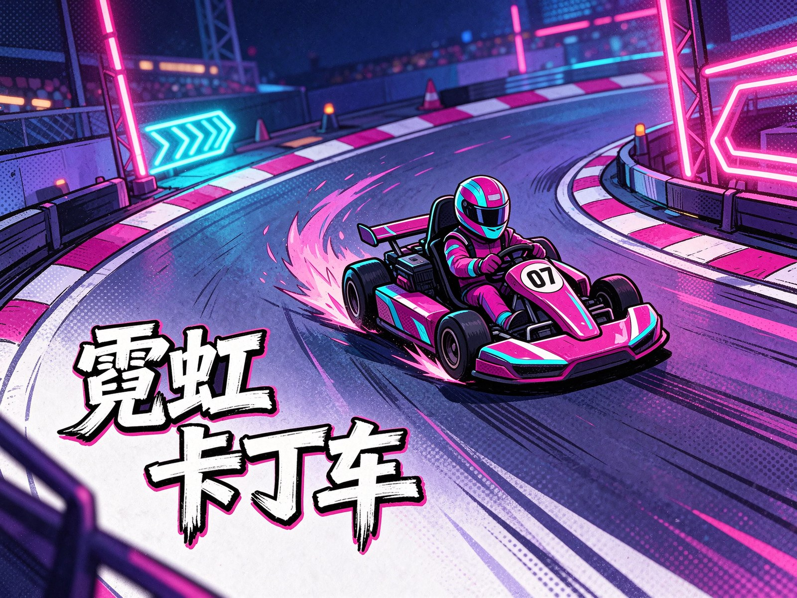

<h1 align="center">霓虹卡丁车 · NEON KART</h1>

俯视角霓虹竞速小游戏，网页即玩，支持联机对战与积分榜

  <a href="https://aiyangdie.github.io/neon-kart/">在线游玩</a> ·
  <a href="https://github.com/aiyangdie/neon-kart/releases">下载桌面版</a> ·
  <a href="LICENSE">MIT 许可</a>

## 简介

一款赛博配色的俯视角赛车小游戏：漂移过弯、吃道具、刷圈速。网页版打开即玩，也能下载 Windows 安装包或便携版；网页版 zip 在 Releases 里。

## 功能

- **网页即玩**：GitHub Pages 直开，无需下载
- **联机竞速**：创建 / 加入房间，2 人实时对战（PeerJS）
- **积分排行榜**：名次积分 + 圈速奖励，本机总榜
- **车辆手感**：车头朝向与行驶方向对齐，漂移与氮气独立按键
- **桌面版**：Windows 安装包与便携版，支持 F11 全屏

## 操作

| 操作 | 默认键 |
|---|---|
| 油门 / 刹车 | W / S |
| 转向 | A / D |
| 漂移 | Space |
| 氮气 | Shift |
| 道具 | Q |
| 暂停 | Esc |
| 全屏（桌面版） | F11 |

## 版本说明

v1.1 修复了车辆侧向行驶的朝向问题，加入联机竞速与积分排行榜。历史版本见 [Releases](https://github.com/aiyangdie/neon-kart/releases)。

## 许可证

MIT ｜ 维护者 [@aiyangdie](https://github.com/aiyangdie) · [@aiyangjan](https://github.com/aiyangjan)
